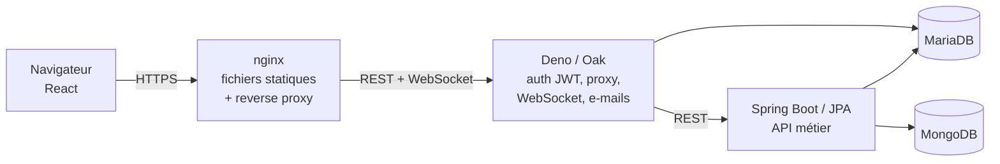

# Kanban – application collaborative de gestion de tâches

Application web de type kanban réalisée en binôme par Liutwin Piernet et Kévin Tambon dans le cadre du projet SI-SOR du Master Informatique de l’Université de Bretagne Occidentale (2026).

Elle repose sur deux backends aux rôles séparés : un serveur Deno qui gère l’authentification, le temps réel et sert de passerelle, et une API REST Spring Boot qui porte la logique métier et l’accès aux données, réparties entre MariaDB et MongoDB.

## Architecture



| Composant | Rôle |
|---|---|
| **React + TypeScript (Vite)** | Interface : tableaux, glisser-déposer des tâches et des colonnes (dnd-kit), pages d’administration |
| **Deno / Oak** | Authentification JWT, réinitialisation du mot de passe, proxy vers Spring, WebSocket pour le temps réel |
| **Spring Boot / JPA** | API REST métier documentée avec OpenAPI (Swagger), export PDF des tableaux, envoi d’e-mails |
| **MariaDB** | Utilisateurs, tableaux, colonnes, tâches, participations, journal d’activité, jetons de réinitialisation. Triggers et procédures stockées pour le déplacement des tâches et des colonnes |
| **MongoDB** | Commentaires et pièces jointes |
| **nginx** | Point d’entrée unique en HTTPS, sert le frontend et relaie les appels vers Deno |

Seul nginx est exposé. Deno et Spring ne sont joignables qu’à l’intérieur du réseau Docker.

## Fonctionnalités

- Création de compte, connexion, mot de passe oublié avec lien envoyé par e-mail
- Tableaux : création, modification, suppression, invitation et gestion des membres
- Colonnes : création, suppression, réorganisation par glisser-déposer
- Tâches : création, modification, déplacement entre colonnes, attribution, date limite, priorité, statut terminé
- Commentaires et pièces jointes sur les tâches
- Temps réel par WebSocket : mise à jour des tableaux chez tous les membres connectés, statut en ligne des utilisateurs, notifications
- Notifications par e-mail : inscription, invitation, nouveau commentaire
- Journal des actions et recherche de tâches par mot-clé, utilisateur ou priorité
- Page « Mes tâches », profil avec avatar, export PDF d’un tableau
- Administration : gestion des comptes et statistiques globales

## Lancer le projet en local

### Prérequis

Docker, JDK 21, Deno 2 et Node.js 22.

### 1. Bases de données

Les bases tournent dans des conteneurs jetables, rien n’est installé sur la machine.

```bash
docker run -d --name kanban-mariadb -p 3306:3306 \
  -e MARIADB_ROOT_PASSWORD=dev -e MARIADB_DATABASE=kanban mariadb:11
docker run -d --name kanban-mongo -p 27017:27017 mongo:7
```

Création du schéma (tables, triggers, procédures) puis du jeu de données de démonstration :

```bash
docker exec -i kanban-mariadb mariadb -uroot -pdev kanban < "Documentation/bdd_(re)initialisation.sql"
docker exec -i kanban-mariadb mariadb -uroot -pdev kanban < Documentation/bdd_donnees.sql
docker exec -i kanban-mongo mongosh < "Documentation/mongo_init(again).js"
docker exec -i kanban-mongo mongosh < Documentation/mongo_donnees.js
```

### 2. Configuration

Les identifiants ne sont jamais versionnés. Créer les deux fichiers suivants (ils sont dans le `.gitignore`).

`spring/src/main/resources/application-local.properties`

```properties
APP_BASE_URL=http://localhost:3000/
DB_MARIA_URL=jdbc:mariadb://localhost:3306/kanban
DB_MARIA_USER=root
DB_MARIA_PASSWORD=dev
DB_MONGO_URL=mongodb://localhost:27017/e22408439_kanban
MAIL_HOST=
MAIL_PORT=
MAIL_USERNAME=
MAIL_PASSWORD=
```

`deno/.env`

```bash
SPRING_URL=http://localhost:8081
APP_BASE_URL=http://localhost:3000
PORT=8000
DB_HOST=localhost
DB_PORT=3306
DB_NAME=kanban
DB_USER=root
DB_PASSWORD=dev
JWT_SECRET=   # chaîne aléatoire, par exemple : openssl rand -hex 32
```

Sans serveur SMTP, l’application fonctionne mais les e-mails ne partent pas.

### 3. Démarrage

Dans trois terminaux :

```bash
cd spring && ./gradlew bootRun     # API sur http://localhost:8081/api/v1
cd deno   && deno task dev         # passerelle sur http://localhost:8000
cd client && npm install && npm run dev   # interface sur http://localhost:3000
```

Vite relaie `/api/v1` et `/ws` vers Deno, il suffit donc d’ouvrir http://localhost:3000.

La documentation de l’API est disponible sur http://localhost:8081/api/v1/swagger-ui/index.html.

### 4. Tests

```bash
cd deno && deno test --allow-net --allow-read --allow-env
```

Les plans de test côté métier et le détail des tests unitaires Deno sont dans `Documentation/`.

## Déploiement avec Docker Compose

Le `docker-compose.yml` construit et lance nginx (avec le frontend), Deno et Spring. Les bases de données sont externes : leurs paramètres, le secret JWT et la configuration mail sont lus dans un fichier `.env` à la racine (non versionné), avec les mêmes variables que ci-dessus.

nginx sert l’application en HTTPS et attend un certificat dans `client/certs/`. Pour un certificat auto-signé :

```bash
mkdir -p client/certs
openssl req -x509 -nodes -days 365 -newkey rsa:2048 \
  -keyout client/certs/key.pem -out client/certs/cert.pem \
  -subj "/CN=localhost" -addext "subjectAltName=DNS:localhost"
```

Puis :

```bash
docker compose up --build -d
```

L’application est accessible sur https://localhost:8443 (le port 8080 redirige vers HTTPS).

## Limites connues

- Avec plusieurs clients connectés, le réordonnancement des colonnes peut diverger : la position cible est transmise sous forme de numéro absolu calculé au début du glisser-déposer. Il faudrait transmettre les identifiants des colonnes voisines.
- Le déplacement d’une tâche écrase son créateur par l’auteur du déplacement dans la procédure `deplacer_tache`. Il faudrait un champ distinct pour l’auteur de la dernière modification.
- Aucun e-mail n’est envoyé lorsqu’un membre est retiré d’un tableau ou qu’un compte est supprimé.

## Documentation

Le dossier `Documentation/` contient le sujet, le schéma des bases (MariaDB et MongoDB), les scripts d’initialisation, les plans de test et la description détaillée des technologies et fonctionnalités.
